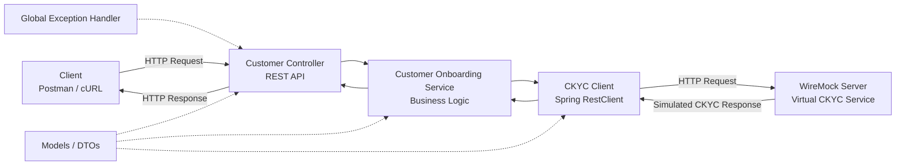

# Banking Customer Onboarding – CKYC Service Virtualization

A Spring Boot-based banking customer onboarding application that integrates with an external **Central KYC (CKYC) service** using REST APIs. The external CKYC dependency is simulated using **WireMock**, enabling reliable development and integration testing without depending on a live external banking service.

The project demonstrates service virtualization, REST API integration, error handling, timeout management, and automated integration testing.

---

## Table of Contents

1. [Project Overview](#-project-overview)
2. [Problem Statement](#-problem-statement)
3. [Solution](#-solution)
4. [System Architecture](#-system-architecture)
5. [End-to-End Request Flow](#-end-to-end-request-flow)
6. [Project Structure](#-project-structure)
7. [Technology Stack](#-technology-stack)
8. [Core Components](#-core-components)
9. [Service Virtualization Using WireMock](#-service-virtualization-using-wiremock)
10. [Test Scenarios](#-test-scenarios)
11. [Exception Handling](#-exception-handling)
12. [Configuration](#-configuration)
13. [How to Run](#-how-to-run)
14. [Running Automated Tests](#-running-automated-tests)
15. [Key Learnings](#-key-learnings)

---

## 1. Project Overview

In a real banking environment, customer onboarding involves validating customer information against external systems such as the Central KYC Registry.

An external CKYC service may:

- Return valid customer KYC information.
- Indicate that a customer is pending verification.
- Reject a customer.
- Return a customer-not-found response.
- Become temporarily unavailable.
- Respond slowly or time out.
- Return an invalid or unexpected response.

Depending on an external service during development and testing creates several challenges.

This project addresses these challenges through **Service Virtualization**.

Instead of calling a real CKYC system, the application communicates with a simulated CKYC service powered by WireMock.

### Project objectives

- Build a REST-based customer onboarding application using Spring Boot.
- Integrate with an external CKYC service using Spring `RestClient`.
- Simulate external CKYC responses using WireMock.
- Handle success, business failures, server failures, timeouts, and malformed responses.
- Implement centralized exception handling.
- Validate the complete integration flow through automated tests.

---

## 2. Problem Statement

Consider a bank developing a customer onboarding application.

When a new customer submits their information, the bank needs to verify the customer's KYC details through an external CKYC service.

The normal integration looks like this:

```text
Banking Application
        |
        v
External CKYC Service
        |
        v
KYC Verification Result
```

However, the real CKYC service may not always be available to developers or testers.

For example:

- The external service may be unavailable in a development environment.
- Access may require credentials or network permissions.
- Testing a timeout scenario against a real service is difficult.
- Reproducing a specific error response consistently is challenging.
- Integration tests may become dependent on another team's infrastructure.

**The challenge:** How can we develop and test our banking application independently of the actual CKYC service?

**Answer:** Service Virtualization using WireMock.

---

## 3. Solution

We created a Spring Boot application that communicates with a virtual CKYC service.

WireMock acts as the simulated external CKYC system and returns predefined responses based on the incoming request.

This allows us to test different real-world integration scenarios in a controlled and repeatable environment.

```text
                 CUSTOMER
                    |
                    v
             REST API Request
                    |
                    v
        BANKING ONBOARDING SERVICE
             (Spring Boot)
                    |
                    v
             CKYC REST CLIENT
                    |
                    v
             WIREMOCK SERVER
             (Virtual CKYC)
                    |
          +---------+---------+
          |         |         |
          v         v         v
        Valid     Pending   Rejected
        Response  Response  Response
          |
          +--------------------------+
          |                          |
          v                          v
       Error Scenarios          Success Flow
       404 / 503 / 504          Onboarding Result
       / 502                         |
          |                          |
          +------------+-------------+
                       |
                       v
                 API Response
```

The application does not require a live CKYC environment to test these scenarios.

---

## 4. System Architecture

The application follows a layered architecture.

### Architecture Diagram

GitHub supports Mermaid diagrams and renders the following architecture visually.



### Architecture Components

| Component | Responsibility |
|---|---|
| Client | Sends customer onboarding requests |
| Controller | Exposes REST endpoints and handles HTTP requests |
| Service Layer | Implements customer onboarding business logic |
| CKYC Client | Communicates with the external CKYC service |
| WireMock Server | Simulates the external CKYC service |
| Model Layer | Contains request and response objects |
| Exception Layer | Handles application and integration errors |

### Why this architecture?

Each layer has a separate responsibility.

For example, the controller does not directly communicate with WireMock. It delegates the business operation to the service layer, which uses the CKYC client.

This separation improves:

- Maintainability
- Testability
- Reusability
- Separation of concerns
- Ease of replacing the virtual service with a real external service

---

## 5. End-to-End Request Flow

Let's understand what happens when a customer submits an onboarding request.

**Step 1: Customer submits a request**

A client sends an HTTP request to the customer onboarding REST API.

**Step 2: Controller receives the request**

The controller accepts the request and delegates the operation to the service layer.

**Step 3: Service executes business logic**

The onboarding service coordinates the customer onboarding process and invokes the CKYC client.

**Step 4: CKYC client makes an HTTP call**

The CKYC client uses Spring's `RestClient` to communicate with the configured CKYC service URL.

**Step 5: WireMock processes the request**

WireMock matches the incoming request against its predefined stubs.

Depending on the customer identifier or matching conditions, it returns a configured response.

**Step 6: Application processes the response**

The CKYC client maps the external response into Java objects.

The service layer interprets the verification result.

**Step 7: Controller returns the final response**

The client receives the onboarding result or an appropriate error response.

---

## 6. Project Structure

```text
banking-customer-onboarding/
│
├── .mvn/
│   └── wrapper/
│
├── src/
│   │
│   ├── main/
│   │   │
│   │   ├── java/
│   │   │   └── com/bank/bankingcustomeronboarding/
│   │   │       │
│   │   │       ├── BankingCustomerOnboardingApplication.java
│   │   │       │
│   │   │       ├── controller/
│   │   │       │   ├── CustomerController.java
│   │   │       │   ├── CustomerOnboardingController.java
│   │   │       │   └── HealthController.java
│   │   │       │
│   │   │       ├── service/
│   │   │       │   └── CustomerOnboardingService.java
│   │   │       │
│   │   │       ├── client/
│   │   │       │   └── CKYCClient.java
│   │   │       │
│   │   │       ├── model/
│   │   │       │   ├── CustomerRequest.java
│   │   │       │   ├── CKYCResponse.java
│   │   │       │   ├── OnboardingResponse.java
│   │   │       │   └── ErrorResponse.java
│   │   │       │
│   │   │       ├── exception/
│   │   │       │   ├── GlobalExceptionHandler.java
│   │   │       │   └── CkycInvalidResponseException.java
│   │   │       │
│   │   │       └── mock/
│   │   │           └── CKYCMockServer.java
│   │   │
│   │   └── resources/
│   │       └── application.properties
│   │
│   └── test/
│       └── java/
│           └── com/bank/bankingcustomeronboarding/
│               ├── BankingCustomerOnboardingApplicationTests.java
│               │
│               └── integration/
│                   └── CustomerOnboardingIntegrationTest.java
│
├── .gitignore
├── .gitattributes
├── mvnw
├── mvnw.cmd
└── pom.xml
```

---

## 7. Technology Stack

| Technology | Purpose |
|---|---|
| Java 21 | Programming language |
| Spring Boot 4.1.2 | Application framework |
| Spring Web | REST API development |
| Spring RestClient | HTTP communication with CKYC |
| WireMock 3.13.1 | External service virtualization |
| JUnit 5 | Automated testing |
| Maven | Build and dependency management |
| Jackson | JSON serialization and deserialization |
| IntelliJ IDEA | Development environment |

---

## 8. Core Components

### 8.1 Customer Controller

The controller layer exposes REST APIs to the client.

Responsibilities:

- Accept HTTP requests.
- Validate and receive request data.
- Invoke the service layer.
- Return appropriate HTTP responses.

The controller should focus on HTTP communication rather than implementing business logic.

### 8.2 Customer Onboarding Service

This is the business logic layer.

Responsibilities:

- Coordinate the customer onboarding process.
- Invoke the CKYC client.
- Interpret CKYC verification results.
- Determine the final onboarding status.
- Return an appropriate response to the controller.

### 8.3 CKYC Client

The CKYC client is responsible for communicating with the external CKYC system.

It uses Spring `RestClient` to perform HTTP communication.

Responsibilities:

- Construct external API requests.
- Send HTTP requests to the configured CKYC URL.
- Deserialize JSON responses into Java objects.
- Handle external service errors.
- Apply connection and read timeout configurations.

The client is designed so that the configured CKYC URL can point to WireMock during local development and testing.

### 8.4 WireMock Server

WireMock acts as the virtual CKYC service.

It simulates the behavior of an external service without requiring the actual CKYC infrastructure.

It can return predefined HTTP responses, response bodies, and artificial delays.

### 8.5 Model Layer

The model package contains the Java objects used to exchange data between application layers.

| Class | Responsibility |
|---|---|
| `CustomerRequest` | Represents incoming customer information |
| `CKYCResponse` | Represents the response received from CKYC |
| `OnboardingResponse` | Represents the final onboarding result |
| `ErrorResponse` | Represents standardized error information |

### 8.6 Exception Layer

The exception package provides centralized error handling.

- `GlobalExceptionHandler`: Handles exceptions and converts them into structured HTTP responses.
- `CkycInvalidResponseException`: Represents an invalid or unexpected CKYC response.

---

## 9. Service Virtualization Using WireMock

### What is Service Virtualization?

Service virtualization is a technique used to simulate the behavior of an external dependency.

Instead of calling the actual external service, the application communicates with a simulated service that behaves according to predefined rules.

In this project:

- Real external dependency: CKYC Registry.
- Virtualized dependency: WireMock CKYC server.
- Client making the request: Spring `RestClient`.
- Application consuming the response: Banking Customer Onboarding Service.

### Why WireMock?

WireMock allows us to:

- Simulate HTTP responses.
- Configure different response status codes.
- Return custom JSON response bodies.
- Simulate network delays.
- Reproduce failures consistently.
- Verify whether the expected external API was called.

### Example

Imagine the CKYC service normally returns:

```json
{
  "customerId": "CUST101",
  "status": "VERIFIED"
}
```

WireMock can return this response whenever the configured matching request is received.

Similarly, it can return a `503 Service Unavailable` response or simulate a delayed response.

This makes testing independent of the real external service.

---

## 10. Test Scenarios

The project implements seven important CKYC integration scenarios.

| Customer ID | Scenario | Simulated Behavior | Expected Application Result |
|---|---|---|---|
| CUST101 | Success | HTTP 200, VERIFIED | SUCCESS |
| CUST102 | Pending | HTTP 200, PENDING | PENDING |
| CUST103 | Rejected | HTTP 200, REJECTED | REJECTED |
| CUST104 | Customer Not Found | HTTP 404 | Controlled 404 response |
| CUST105 | Service Unavailable | HTTP 503 | Controlled 503 response |
| CUST106 | Timeout | 5-second delay | Controlled 504 response |
| CUST107 | Malformed JSON | Invalid JSON with HTTP 200 | Controlled 502 response |

### Scenario 1: Successful Verification

The virtual CKYC service returns a valid customer record with `VERIFIED` status.

The onboarding application processes the response and returns a successful onboarding result.

### Scenario 2: Pending Verification

The CKYC service returns `PENDING`.

The application recognizes that the customer verification is not yet complete and returns a pending onboarding result.

### Scenario 3: Rejected Verification

The CKYC service returns `REJECTED`.

The application returns a rejected onboarding result.

### Scenario 4: Customer Not Found

The virtual CKYC service returns HTTP 404.

The application handles the external service response and returns a controlled error response.

### Scenario 5: CKYC Service Unavailable

The virtual CKYC service returns HTTP 503.

This simulates an external dependency that is temporarily unavailable.

The application handles the failure instead of exposing an uncontrolled exception.

### Scenario 6: Timeout

WireMock introduces a 5-second response delay.

The CKYC client has a configured read timeout of 2 seconds.

Since the simulated service takes longer than the configured timeout, the client times out and the application returns a controlled HTTP 504 response.

### Scenario 7: Malformed JSON

WireMock returns an invalid JSON response with HTTP 200.

Although the HTTP status indicates success, the response cannot be correctly deserialized.

The application identifies the invalid response and returns a controlled HTTP 502 response.

---

## 11. Exception Handling

External service integrations can fail in multiple ways.

For example:

- HTTP errors
- Connection failures
- Read timeouts
- Invalid JSON
- Unexpected response structures

Rather than allowing these failures to produce uncontrolled application errors, the project uses centralized exception handling.

The `GlobalExceptionHandler` converts relevant exceptions into standardized error responses.

This provides:

- Consistent error response structures.
- Better separation of business logic and error handling.
- More predictable API behavior.
- Easier debugging and testing.

The project specifically demonstrates controlled handling of HTTP 404, HTTP 503, HTTP 504, and HTTP 502 scenarios.

---

## 12. Configuration

The application uses `application.properties` for configuration.

Example configuration:

```properties
spring.application.name=banking-customer-onboarding

ckyc.service.base-url=${CKYC_SERVICE_BASE_URL:http://localhost:8081}

ckyc.base-url=http://localhost:8081
```

The CKYC client uses the configured `ckyc.base-url` property.

The default virtual CKYC service URL is:

```text
http://localhost:8081
```

The application also configures connection and read timeouts in the CKYC client.

For this project, the read timeout is 2 seconds, allowing the timeout scenario to be tested using WireMock's artificial delay.

---

## 13. How to Run

### Prerequisites

Make sure you have:

- Java 21 or compatible configured JDK.
- Git.
- IntelliJ IDEA or another Java IDE.
- A terminal.

### Step 1: Clone the repository

```bash
git clone https://github.com/guptaprashantOO3/banking-customer-onboarding.git
```

### Step 2: Navigate to the project

```bash
cd banking-customer-onboarding
```

### Step 3: Build the project

On macOS/Linux:

```bash
./mvnw clean install
```

On Windows:

```bash
mvnw.cmd clean install
```

### Step 4: Run the application

On macOS/Linux:

```bash
./mvnw spring-boot:run
```

On Windows:

```bash
mvnw.cmd spring-boot:run
```

The Spring Boot application uses the default port `8080`, unless configured otherwise.

The WireMock server is configured to use port `8081` in the local setup.

---

## 14. Running Automated Tests

The project contains automated tests using JUnit 5 and Spring Boot testing support.

### Run all tests

macOS/Linux:

```bash
./mvnw test
```

Windows:

```bash
mvnw.cmd test
```

### Run the integration test class only

```bash
./mvnw -Dtest=CustomerOnboardingIntegrationTest test
```

### What do the integration tests verify?

The tests validate:

- Customer onboarding API behavior.
- Successful CKYC verification.
- Pending and rejected verification.
- External service HTTP errors.
- Timeout handling.
- Invalid JSON handling.
- Expected HTTP status codes and response bodies.
- Interaction with the virtual CKYC service.

The project was successfully tested with the following result:

| Metric | Result |
|---|---:|
| Tests run | 7 |
| Failures | 0 |
| Errors | 0 |
| Skipped | 0 |

**All seven integration test scenarios passed in the recorded test run.**

---

## 15. Key Learnings

This project helped demonstrate practical concepts used in enterprise Java and banking applications.

### Technical concepts

1. **Service Virtualization:** Simulating external services without depending on their real infrastructure.
2. **REST API Development:** Building REST endpoints using Spring Boot.
3. **HTTP Communication:** Integrating external services using Spring `RestClient`.
4. **Timeout Management:** Handling slow external dependencies.
5. **Exception Handling:** Converting integration failures into controlled API responses.
6. **JSON Serialization:** Mapping JSON responses to Java objects.
7. **Integration Testing:** Testing interactions between application components and external dependencies.
8. **Mocking External Systems:** Using WireMock to reproduce different external service behaviors.

### Real-world relevance

In enterprise banking systems, applications often depend on multiple external services.

Examples include:

- CKYC verification.
- Payment gateways.
- Credit bureau services.
- Account verification services.
- Fraud detection systems.
- Notification services.

Service virtualization makes it possible to test these integrations reliably even when the actual external services are unavailable.

---

## Future Enhancements

Potential improvements for a more production-oriented integration include:

- Retry mechanisms with exponential backoff.
- Circuit breaker implementation using Resilience4j.
- Structured logging and distributed tracing.
- Authentication and authorization for external API calls.
- Externalized environment-specific configuration.
- Contract testing between the banking application and CKYC service.
- Docker-based execution of the application and virtual service.

---

## Author

**Prashant Kumar**

B.Tech – Electrical Engineering

GitHub: [@guptaprashantOO3](https://github.com/guptaprashantOO3)

Project Repository: [Banking Customer Onboarding – CKYC Service Virtualization](https://github.com/guptaprashantOO3/banking-customer-onboarding)

---

**This project demonstrates how service virtualization can make external service integrations more testable, reliable, and independent of third-party infrastructure.**
